# Linces ITC

Aplicación web para estudiantes del **TecNM Campus Celaya**. Consume el **API SII ITC** en tiempo real para mostrar perfil, calificaciones, kardex y horario. Además incluye una funcionalidad propia: la **Bolsa de Servicio Social, Residencias y Proyectos**, que cruza los requisitos de cada vacante con los datos académicos reales del alumno.

> Examen 3: Consumo de API y Desarrollo de Interfaz Web.
> Materia: Tópicos Avanzados de Desarrollo Web.
> Proyecto académico. No es un sitio oficial del TecNM.

| | URL |
|---|---|
| Aplicación (alumnos) | https://linces-itc.onrender.com |
| Panel de administración | https://linces-itc.onrender.com/admin/login |
| Repositorio | https://github.com/21031562/Linces-ITC |

_Si Render asignó URLs distintas, actualízalas aquí._

---

## Contenido

1. [Cumplimiento del examen, punto por punto](#1-cumplimiento-del-examen-punto-por-punto)
2. [Arquitectura de dos capas de backend](#2-arquitectura-de-dos-capas-de-backend)
3. [Flujo de información](#3-flujo-de-información)
4. [Funcionamiento de cada sección](#4-funcionamiento-de-cada-sección)
5. [Lógica de negocio del backend local](#5-lógica-de-negocio-del-backend-local)
6. [Tecnologías elegidas y justificación](#6-tecnologías-elegidas-y-justificación)
7. [Seguridad](#7-seguridad)
8. [Diseño visual](#8-diseño-visual)
9. [Instalación y ejecución local](#9-instalación-y-ejecución-local)
10. [Despliegue en Render](#10-despliegue-en-render)
11. [Endpoints](#11-endpoints)
12. [Capturas de pantalla](#12-capturas-de-pantalla)
13. [Preguntas frecuentes para la defensa](#13-preguntas-frecuentes-para-la-defensa)
14. [Guion de la exposición](#14-guion-de-la-exposición)
15. [Estructura del repositorio y equipo](#15-estructura-del-repositorio-y-equipo)

---

## 1. Cumplimiento del examen, punto por punto

Cada fila cita un lineamiento del documento y dice dónde y cómo se cumple.

### Objetivo general: arquitectura de dos capas de backend

| Lineamiento | Cómo se cumple | Evidencia |
|---|---|---|
| API ITC como backend general compartido (autenticación y datos institucionales) | Toda la autenticación y todos los datos académicos vienen del SII en vivo. No hay copia local de calificaciones, kardex ni horario. | `bff/src/lib/sii.ts` |
| Backend local propio: lógica de negocio, persistencia y funcionalidades específicas | **BFF** (Express + TS): sesiones, cálculos y validaciones. **vacantes-service** (Express + TS): funcionalidad adicional. Persistencia en 2 proyectos de Supabase. | `bff/`, `vacantes-service/`, `supabase/` |
| Framework moderno de la lista, usado de forma consistente | **React + Vite** en todo el frontend, incluido el panel de administración | `frontend/` |

### Punto 1: Autenticación

| Lineamiento | Cómo se cumple | Evidencia |
|---|---|---|
| Pantalla de login con correo y contraseña | Formulario con validación, botón para mostrar u ocultar la contraseña y estado de carga | `frontend/src/pages/Login.tsx` |
| `POST /api/login` mediante solicitud HTTP | El navegador envía las credenciales al BFF y el BFF hace `POST https://sii.celaya.tecnm.mx/api/login` | `bff/src/routes/auth.ts`, `bff/src/lib/sii.ts → siiLogin()` |
| Almacenar de forma segura el token JWT | El JWT se guarda **cifrado con AES-256-GCM** en Supabase A, ligado a un ID de sesión aleatorio de 256 bits. El navegador solo recibe ese ID en una cookie `HttpOnly; Secure; SameSite=Lax; __Host-`. El token **nunca llega al navegador**, así que no está en `localStorage`, ni en `document.cookie`, ni en la pestaña Red. | `bff/src/services/sessionStore.ts`, `bff/src/lib/crypto.ts` |
| Errores: credenciales incorrectas | El SII responde HTTP 200 con `status: 401` en el body. El BFF lo detecta y responde `401 INVALID_CREDENTIALS`. | `sii.ts → siiLogin()` |
| Errores: servidor no disponible | Timeout de 10 s, errores de red o 5xx del SII se convierten en `503 SII_UNAVAILABLE`. Si nuestro propio backend está dormido, el frontend muestra `BACKEND_DOWN`. | `sii.ts`, `frontend/src/lib/api.ts` |
| Errores: campos vacíos | Se valida en el cliente (mensaje por campo) y también en el servidor (zod, `400`) | `Login.tsx`, `auth.ts → loginSchema` |
| Redirigir al dashboard tras autenticar | `navigate('/dashboard')` | `Login.tsx` |
| Proteger rutas: si el token no existe **o expiró**, regresar al login | `RequireAuth` envuelve todas las rutas privadas. El servidor valida en cada petición: que la sesión exista, la expiración leída del `exp` del JWT, 20 min de inactividad y el rechazo del SII. El cliente programa el cierre al vencer el token. | `frontend/src/auth/RequireAuth.tsx`, `AuthContext.tsx`, `bff/src/middleware/session.ts` |

### Punto 2: Información del estudiante

| Lineamiento | Cómo se cumple | Evidencia |
|---|---|---|
| Consumir `GET /api/movil/estudiante` con el JWT | El BFF lo llama con `Authorization: Bearer <token descifrado>` | `bff/src/routes/academico.ts → /estudiante` |
| Dashboard personalizado con el perfil | Saludo con nombre, foto, número de control, correo, semestre, promedios, créditos y materias | `frontend/src/pages/Dashboard.tsx` |
| Indicadores visuales (tarjetas, gráficas, íconos) | Tarjetas de KPI; gráfica de área del promedio por semestre; anillos de progreso hacia servicio social, residencia y egreso; medio anillo de créditos complementarios; clases de hoy | `Dashboard.tsx`, `styles/dashboard.css` |
| Spinner o skeleton | Skeleton de todo el panel mientras carga, y skeletons por tarjeta (gráfica, clases) | `DashboardSkeleton`, `components/Feedback.tsx` |
| Mensaje claro si el token es inválido o falla la solicitud | `ErrorState` explica el motivo (sesión expirada, token rechazado por el SII, SII caído), ofrece **Reintentar** o **Iniciar sesión** y redirige con cuenta regresiva | `components/Feedback.tsx` |

### Punto 3: Calificaciones

| Lineamiento | Cómo se cumple | Evidencia |
|---|---|---|
| Consumir `GET /api/movil/estudiante/calificaciones` | `GET /api/calificaciones` del BFF | `academico.ts` |
| Tabla o tarjetas | Las dos vistas, con un selector para cambiar entre ellas | `pages/Calificaciones.tsx` |
| Nombre de materia, periodo y **calificación final** | El SII solo entrega parciales (en el campo `calificaiones`, así viene escrito en el API). El BFF calcula la final como el promedio de las unidades capturadas y además muestra cada unidad. | `bff/src/services/academico.ts → calificaciones()` |
| Búsqueda en tiempo real por materia o periodo | El buscador filtra por nombre, clave o periodo; hay selector de periodo y filtro por color | `Calificaciones.tsx` |
| Semáforo verde / amarillo / rojo | **Verde** ≥ 85 sin unidades reprobadas. **Amarillo** 70–84, o alguna unidad < 70. **Rojo** < 70. Hay leyenda visible y la mínima aprobatoria del TecNM es 70. | `academico.ts → semaforo()` |

### Punto 4: Kardex y horario

| Lineamiento | Cómo se cumple | Evidencia |
|---|---|---|
| Consumir los endpoints de kardex y horarios | `GET /api/kardex` y `GET /api/horario` del BFF | `academico.ts` |
| Rutas independientes | `/kardex` y `/horario` | `frontend/src/App.tsx` |
| Kardex completo y estructurado | Agrupado por semestre en acordeón, con créditos y promedio por semestre; resumen general (avance, créditos, promedio, aprobadas); búsqueda e impresión | `pages/Kardex.tsx` |
| Horario por día y hora | Cuadrícula semanal hora × día con salón (en celular, un día a la vez) y vista alterna por materia | `pages/Horario.tsx` |
| Navegación fluida | SPA con React Router y menú superior fijo; no se recarga la página | `components/Layout.tsx` |

### Punto 5: Funcionalidad adicional

| Lineamiento | Cómo se cumple | Evidencia |
|---|---|---|
| Original y con valor real para los estudiantes | **Bolsa de Servicio Social, Residencias y Proyectos**: dice al alumno en qué vacantes califica según su avance real en el SII | [docs/PROPUESTA.md](docs/PROPUESTA.md) |
| Su propio backend de administración | `vacantes-service` con autenticación propia (bcrypt), roles `admin` y `revisor`, CRUD de organizaciones y vacantes, revisión de postulaciones, estadísticas y bitácora | `vacantes-service/src/routes/admin.ts`, `frontend/src/admin/` |
| La información puede ser simulada | Organizaciones y vacantes de ejemplo **ficticias**. Los puntos 1 a 4 nunca usan datos simulados. | `supabase/vacantes/002_seed_simulado.sql` |
| Propuesta que justifique la utilidad | Problema, solución, beneficios y por qué es confiable | [docs/PROPUESTA.md](docs/PROPUESTA.md) |

### Backend, entregables e indicaciones finales

| Lineamiento | Cómo se cumple |
|---|---|
| El SII es la **única fuente de verdad** para autenticación y datos académicos | El login se valida contra el SII. Los datos académicos se consultan en vivo en cada petición. En nuestra base solo guardamos sesiones (token cifrado) y una foto mínima de elegibilidad al postular (avance, promedio, semestre y créditos), como evidencia. |
| El backend local es un **intermediario seguro** | El navegador nunca habla con el SII. Solo conoce `/api/*` de su propio dominio; el gateway lo reenvía al BFF y el BFF al SII. |
| Lógica de negocio y funcionalidad adicional en el backend | Ver la [sección 5](#5-lógica-de-negocio-del-backend-local) |
| "Interactuar directamente con la API del SII (no simular respuestas para 1 a 4)" | Cada pantalla de los puntos 1 a 4 se alimenta de una llamada real al SII en ese momento; no hay datos de respaldo, caché persistente ni respuestas simuladas. La intermediación del BFF es la que exige la sección **BackEnd** del mismo documento. |
| Repositorio en GitHub | https://github.com/21031562/Linces-ITC |
| README con instalación, descripción del framework y capturas | Secciones [9](#9-instalación-y-ejecución-local), [6](#6-tecnologías-elegidas-y-justificación) y [12](#12-capturas-de-pantalla) |
| Publicar en Vercel o similar | Render (3 servicios con un Blueprint, `render.yaml`) |
| Creatividad, calidad visual y diseño adicional | Tema verde Linces con logo y fondo propios, paneles oscuros con gráficas de área, anillos de progreso, pista de créditos y diseño responsivo. Ver la [sección 8](#8-diseño-visual). |
| Justificación del framework | [Sección 6](#6-tecnologías-elegidas-y-justificación) |

---

## 2. Arquitectura de dos capas de backend

**Los datos están centralizados y la operación está descentralizada.**
- El SII es la fuente única de los datos académicos, y cada base de Supabase pertenece a un solo servicio.
- Los tres servicios se despliegan, escalan y fallan de forma independiente.

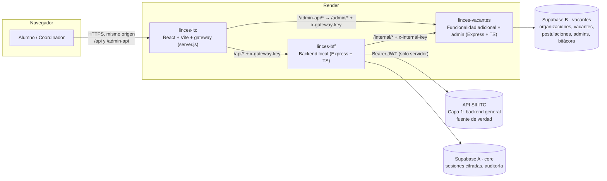

| Capa | Servicio | Responsabilidad | Datos |
|---|---|---|---|
| Presentación | `linces-itc` (frontend + gateway) | Interfaz del alumno y del panel admin. Reenvía `/api` y `/admin-api` del lado del servidor e inyecta las llaves. | — |
| **Backend general (capa 1)** | **API SII ITC** | Autenticación y datos institucionales | Base del TecNM |
| **Backend local (capa 2)** | `linces-bff` | Intermediario seguro: login, sesiones, consumo del SII, cálculos (calificación final, semáforo, kardex por semestre, horario), elegibilidad | Supabase A |
| **Backend local (capa 2)** | `linces-vacantes` | Bolsa de vacantes: API interna para el BFF y API de administración con auth propia | Supabase B |

**¿Por qué el gateway?** `onrender.com` está en la *Public Suffix List*: dos subdominios de Render (`linces-itc` y `linces-bff`) cuentan como **sitios distintos** y las cookies entre ellos serían de terceros, que los navegadores bloquean. Con el gateway, el navegador solo habla con su propio dominio: la cookie es *first-party* y las URLs de los backends nunca se exponen.

---

## 3. Flujo de información

### 3.1 Inicio de sesión

```mermaid
sequenceDiagram
  autonumber
  actor A as Alumno
  participant F as Frontend + gateway
  participant B as BFF
  participant S as API SII ITC
  participant DB as Supabase A
  A->>F: correo + contraseña
  F->>B: POST /auth/login (+ x-gateway-key, x-linces-csrf)
  B->>B: valida campos (zod) y rate limit
  B->>S: POST /api/login
  S-->>B: 200 { status, message.login.token }
  alt credenciales incorrectas
    B-->>F: 401 INVALID_CREDENTIALS
  else SII caído / timeout
    B-->>F: 503 SII_UNAVAILABLE
  end
  B->>S: GET /api/movil/estudiante (Bearer)
  S-->>B: numero_control
  B->>DB: borra sesiones previas del alumno (sesión única)
  B->>DB: inserta sha256(id), JWT cifrado AES-GCM, expira = exp del JWT
  B-->>F: Set-Cookie __Host-linces_sid=<id opaco>; HttpOnly; Secure; SameSite=Lax
  Note over F,B: La respuesta NO contiene el token
  F-->>A: redirige a /dashboard
```

### 3.2 Consulta académica (dashboard, calificaciones, kardex, horario)

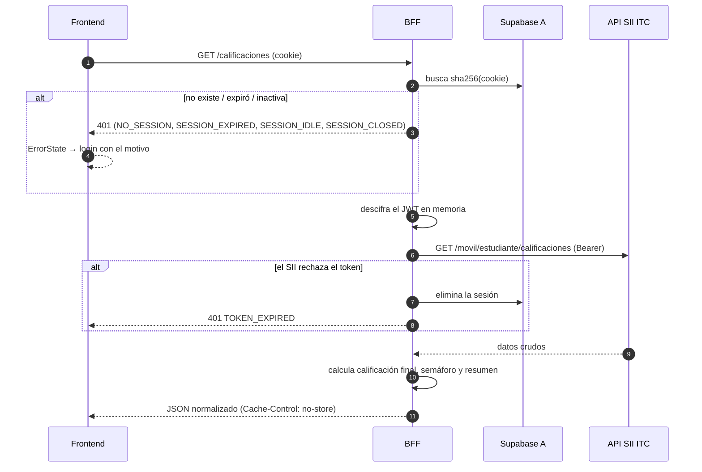

### 3.3 Postulación a una vacante (funcionalidad adicional)

```mermaid
sequenceDiagram
  autonumber
  actor A as Alumno
  participant B as BFF
  participant S as API SII ITC
  participant V as vacantes-service
  participant DB as Supabase B
  actor C as Coordinador
  A->>B: GET /vacantes
  B->>V: GET /internal/vacantes (x-internal-key)
  B->>S: perfil del alumno
  B-->>A: vacantes + requisitos que cumple / le faltan
  A->>B: POST /vacantes/:id/postulaciones {mensaje}
  B->>S: perfil EN VIVO (no se confía en el navegador)
  B->>B: evalúa avance, promedio y semestre + mínimo institucional (70 % / 80 %)
  alt no cumple
    B-->>A: 422 NOT_ELIGIBLE (dice qué le falta)
  end
  B->>V: POST /internal/postulaciones (+ foto de elegibilidad)
  V->>DB: valida cupo, fecha límite y duplicado; inserta
  C->>V: PATCH /admin/postulaciones/:id {aceptada, comentario}
  V->>DB: valida cupo; actualiza; registra en bitácora
  A->>B: GET /postulaciones → ve "Aceptada" + comentario
```

### 3.4 Ciclo de vida de la sesión

| Evento | Qué pasa |
|---|---|
| Vence el `exp` del JWT del SII | El servidor rechaza con `SESSION_EXPIRED` y el cliente cierra la sesión a esa hora |
| 20 min sin actividad | `SESSION_IDLE` (se valida en servidor y en cliente) |
| El SII rechaza el token | Se elimina la sesión y se responde `TOKEN_EXPIRED` |
| Logout en una pestaña | Se borra en BD y **todas las pestañas** regresan al login (BroadcastChannel) |
| Login desde otro navegador o dispositivo | **Sesión única**: la anterior se borra y ese otro lado ve `SESSION_CLOSED` |
| Otra cuenta en otra pestaña | Las demás pestañas se recargan para no mezclar datos de dos alumnos |

---

## 4. Funcionamiento de cada sección

| Sección | Ruta | Qué muestra |
|---|---|---|
| Login | `/login` | Credenciales del SII, errores específicos y el motivo cuando la sesión se cerró |
| Inicio | `/dashboard` | KPIs (promedio, avance, reprobadas), gráfica del promedio por semestre, anillos de metas (servicio social, residencia, egreso), créditos complementarios, ficha del perfil y clases de hoy |
| Calificaciones | `/calificaciones` | Tabla o tarjetas con unidades, calificación final, semáforo y estado; buscador; filtro por periodo y color |
| Kardex | `/kardex` | Historial completo por semestre, resumen, búsqueda, expandir o contraer e impresión |
| Horario | `/horario` | Cuadrícula semanal con salón, día actual resaltado y vista por materia |
| Bolsa | `/bolsa` | Pista de créditos, vacantes con requisitos ✓/✗, filtro "solo en las que califico" y panel de detalle con formulario de postulación |
| Postulaciones | `/postulaciones` | Estado (Enviada → En revisión → Aceptada / Rechazada), comentario del coordinador y opción de cancelar |
| Admin | `/admin/*` | Resumen con gráficas, vacantes (crear, editar, publicar, cerrar), postulaciones (revisar, aceptar, rechazar), organizaciones y bitácora |

---

## 5. Lógica de negocio del backend local

| Regla | Implementación |
|---|---|
| **Calificación final** = promedio de las unidades capturadas | `academico.ts → calificaciones()` |
| **Semáforo**: verde ≥ 85 sin unidades reprobadas, amarillo 70–84 o con alguna unidad < 70, rojo < 70 | `academico.ts → semaforo()` |
| Estado por materia: aprobando, unidad reprobada, reprobando o sin captura | `academico.ts` |
| Kardex agrupado por semestre; créditos y promedio de aprobadas; reconoce "AC/Acreditada" | `academico.ts → kardex()` |
| Horario: interpreta `"07:00-08:00"` por día, rango de horas y si hay clases en sábado | `academico.ts → horario()` |
| Foto del SII: acepta URL o base64 | `academico.ts → normalizarFoto()` |
| **Elegibilidad**: avance, promedio y semestre contra los requisitos de la vacante **más** el mínimo institucional (servicio social 70 %, residencia 80 %) | `services/elegibilidad.ts` |
| Cupo, fecha límite y no duplicar postulaciones | `vacantes-service/src/routes/internal.ts` |
| Al aceptar, no se puede exceder el cupo; roles `admin` / `revisor` | `vacantes-service/src/routes/admin.ts` |

---

## 6. Tecnologías elegidas y justificación

### Frontend: React + Vite

- **Por qué:** una SPA rápida con HMR instantáneo y sin configuración compleja. Los datos son privados por alumno: no necesitan SEO ni renderizado en servidor, así que SSR (Next.js) no aporta y sí agrega costo.
- **Ventajas:** ecosistema grande, build estático ligero y el mismo React que usamos en prácticas anteriores.
- **Librerías:**
  - React 19 y React Router (navegación)
  - Recharts (gráficas)
  - Lucide (íconos)
  - Bricolage Grotesque + Atkinson Hyperlegible, autoalojadas (sin CDN, compatibles con la CSP)
- **Decisión técnica:** en producción, el build lo sirve un **gateway mínimo (`server.js`)** que actúa como proxy hacia los backends. Así se ocultan sus URLs y las cookies quedan *first-party*.

### Backend: Express + TypeScript (Node 22)

- **Por qué:** ya lo dominamos, arranca rápido en el plan gratuito de Render y es suficiente para un BFF. NestJS habría añadido curva de aprendizaje; Laravel requeriría Docker en Render.
- **Librerías:**
  - `helmet` (cabeceras)
  - `express-rate-limit`
  - `zod` (validación)
  - `cookie-parser`
  - `@supabase/supabase-js`
  - `pino` (logs con datos sensibles ocultos)
  - `bcryptjs`

### Datos: Supabase (2 proyectos)

- **A · core:** `sesiones` y `auditoria`. Solo la usa el BFF.
- **B · vacantes:** `organizaciones`, `vacantes`, `postulaciones`, `admins`, `admin_sesiones` y `bitacora_admin`. Solo la usa vacantes-service.
- RLS activado **sin políticas** y permisos revocados: con la llave pública no se puede leer nada. Solo la secret key, que vive en el servidor, tiene acceso.

---

## 7. Seguridad

| Riesgo | Medida |
|---|---|
| Token visible en el navegador | El JWT nunca sale del servidor. La cookie es un ID aleatorio `HttpOnly`, `Secure`, `SameSite=Lax`, con prefijo `__Host-`. `document.cookie`, `localStorage` y `sessionStorage` están vacíos. |
| Robo de la base de sesiones | Solo se guarda el **SHA-256** del ID y el JWT **cifrado AES-256-GCM** con una llave que solo tiene el BFF |
| Ver cómo consumimos el API | El navegador solo ve `/api/...` de su dominio; nunca la URL del SII ni del BFF, ni headers `Authorization`. CSP `connect-src 'self'`. |
| Acceso directo a los backends | El BFF y `/admin` exigen `x-gateway-key`; `/internal` exige `x-internal-key`. Sin llave responden **404**. |
| CSRF | `SameSite`, header obligatorio `x-linces-csrf` y validación de `Origin` (`ALLOWED_ORIGINS`). No hay CORS. |
| Fuerza bruta | 10 intentos por IP y correo cada 10 min (alumnos y admins) |
| Sesiones abandonadas o duplicadas | Expiración por `exp`, inactividad, sesión única por alumno, logout sincronizado entre pestañas y limpieza periódica |
| XSS / clickjacking | CSP estricta, `frame-ancestors 'none'` y Helmet en los 3 servicios |
| Datos privados en caché | `Cache-Control: no-store` |
| Contraseñas de admins | bcrypt (costo 12); comparación de tiempo constante aunque el correo no exista |
| Fugas en logs | Pino oculta cookies, `authorization`, contraseñas y tokens |

> Las DevTools **siempre** muestran las cookies del sitio. Lo que garantiza este diseño es que la cookie no contiene el token del SII, no sirve fuera de este dominio y se revoca en el servidor.

### Auditoría automática

`tools/auditoria.mjs` hace cerca de 70 pruebas sin imprimir nunca tokens ni contraseñas:
- que el bundle no contenga secretos;
- los atributos de la cookie;
- que ninguna respuesta de la API traiga tokens;
- CSRF, accesos sin sesión y path traversal;
- logout revocado en el servidor;
- 404 al entrar directo a los backends;
- RLS de Supabase con la llave pública;
- rate limit;
- `.env` versionados y `npm audit`.

```bash
node tools/auditoria.mjs --url https://linces-itc.onrender.com \
  --bff https://linces-bff.onrender.com --vacantes https://linces-vacantes.onrender.com \
  --supabase https://REF_CORE.supabase.co=sb_publishable_xxx \
  --supabase https://REF_VAC.supabase.co=sb_publishable_yyy --rate
```

---

## 8. Diseño visual

- **Identidad Linces:** logo circular, fondo con el mosaico del lince y paleta verde institucional con dorado para metas y avance.
- **Menú superior** fijo; en celular pasa a una fila deslizable.
- **Paneles oscuros** en Inicio, Calificaciones, Kardex, Horario, Bolsa y Postulaciones:
  - gráfica de área con brillo y línea del mínimo aprobatorio;
  - anillos de progreso;
  - tarjeta destacada con degradado.
- **Pista de créditos** con los hitos de 70 %, 80 % y 100 %, y la proyección si apruebas lo que cursas.
- **Accesibilidad:**
  - foco visible con teclado;
  - el color nunca es la única señal (texto oculto para lectores de pantalla en el semáforo);
  - respeta `prefers-reduced-motion`;
  - tipografía Atkinson Hyperlegible.
- **Responsivo** desde 360 px; el kardex se puede imprimir.

---

## 9. Instalación y ejecución local

**Requisitos**
- Node.js 22 (`nvm install 22`)
- Dos proyectos de Supabase
- Cuenta del SII

```bash
git clone https://github.com/21031562/Linces-ITC.git
cd Linces-ITC
```

**1. Bases de datos.** En **SQL Editor** de cada proyecto, ejecuta:

| Proyecto | Scripts |
|---|---|
| A · core | `supabase/core/001_core.sql` |
| B · vacantes | `supabase/vacantes/001_vacantes.sql` y luego `002_seed_simulado.sql` |

Copia la **Project URL** y la **Secret key** de cada uno (Project Settings → API Keys).

**2. Variables de entorno**

```bash
cp bff/.env.example bff/.env
cp vacantes-service/.env.example vacantes-service/.env
cp frontend/.env.example frontend/.env
ENC=$(node -e "console.log(require('crypto').randomBytes(32).toString('hex'))")
INT=$(node -e "console.log(require('crypto').randomBytes(32).toString('hex'))")
sed -i "s|^SESSION_ENC_KEY=.*|SESSION_ENC_KEY=$ENC|; s|^VACANTES_INTERNAL_KEY=.*|VACANTES_INTERNAL_KEY=$INT|" bff/.env
sed -i "s|^INTERNAL_KEY=.*|INTERNAL_KEY=$INT|" vacantes-service/.env
# Después edita las URLs y Secret keys de Supabase en bff/.env y vacantes-service/.env
```

**3. Instalar y levantar** (3 terminales)

```bash
(cd bff && npm install) && (cd vacantes-service && npm install) && (cd frontend && npm install)

cd vacantes-service && npm run dev   # :4100
cd bff              && npm run dev   # :4000
cd frontend         && npm run dev   # :5173
```

**4. Crear el administrador de la bolsa**

```bash
cd vacantes-service
npm run crear-admin -- coordinacion@ejemplo.com "UnaContraseñaLarga-2026" "Coordinación de Vinculación" admin
```

- Alumnos: http://localhost:5173/login
- Admin: http://localhost:5173/admin/login

---

## 10. Despliegue en Render

1. **New → Blueprint** → repositorio `Linces-ITC`. Render lee `render.yaml`, crea `linces-bff`, `linces-vacantes` y `linces-itc`, y genera y enlaza las llaves compartidas.
2. Captura las variables `sync: false`:

| Servicio | Variables |
|---|---|
| linces-bff | `SUPABASE_CORE_URL`, `SUPABASE_CORE_SECRET_KEY`, `VACANTES_URL`, `ALLOWED_ORIGINS` |
| linces-vacantes | `SUPABASE_VACANTES_URL`, `SUPABASE_VACANTES_SECRET_KEY`, `ALLOWED_ORIGINS` |
| linces-itc | `BFF_URL`, `ADMIN_SERVICE_URL` |

3. `ALLOWED_ORIGINS` debe ser **exactamente** la URL del frontend (`https://linces-itc.onrender.com`, sin `/` final). Si no, aparece "Origen no permitido".
4. Cada `git push` a `main` vuelve a desplegar.

**Notas**
- **Repositorio:** la app de Render en GitHub la debe instalar el **dueño** del repositorio; a un colaborador no le aparece.
- **Plan gratuito:** cada servicio se duerme tras 15 min sin uso y tarda cerca de un minuto en despertar. Antes de la demo abre `/health` de los 3 servicios.
- **Comandos de build:** `npm ci --include=dev && npm run build`. El `--include=dev` es necesario porque con `NODE_ENV=production` npm omitiría TypeScript y Vite.

---

## 11. Endpoints

### BFF (navegador → `/api/*`)

| Método | Ruta | Descripción |
|---|---|---|
| POST | `/auth/login` | Login contra el SII; crea la sesión y la cookie |
| GET | `/auth/session` | Estado de la sesión |
| POST | `/auth/logout` | Elimina la sesión |
| GET | `/estudiante` | Perfil + elegibilidad de servicio social y residencia |
| GET | `/calificaciones` | Materias, unidades, final, semáforo y resumen |
| GET | `/kardex` | Kardex por semestre y resumen |
| GET | `/horario` | Sesiones por día y hora |
| GET | `/vacantes?tipo=&q=` | Vacantes con la elegibilidad del alumno |
| GET | `/vacantes/:id` | Detalle |
| POST | `/vacantes/:id/postulaciones` | Postularse (valida contra el SII) |
| GET | `/postulaciones` | Mis postulaciones |
| POST | `/postulaciones/:id/cancelar` | Cancelar una postulación pendiente |

### vacantes-service

- `/internal/*` (solo el BFF, con `x-internal-key`): vacantes publicadas, detalle, crear, listar y cancelar postulaciones.
- `/admin/*` (panel, vía `/admin-api/*`):
  - `auth/login|logout|me`
  - `estadisticas`
  - CRUD de `organizaciones` y `vacantes`
  - `postulaciones` (listar y cambiar estado)
  - `bitacora`

---

## 12. Capturas de pantalla

> ⚠️ Antes de entregar, reemplaza estas capturas por las de **producción conectada al SII real**, con los mismos nombres de archivo en `docs/capturas/`.

| Login | Error de credenciales |
|---|---|
| 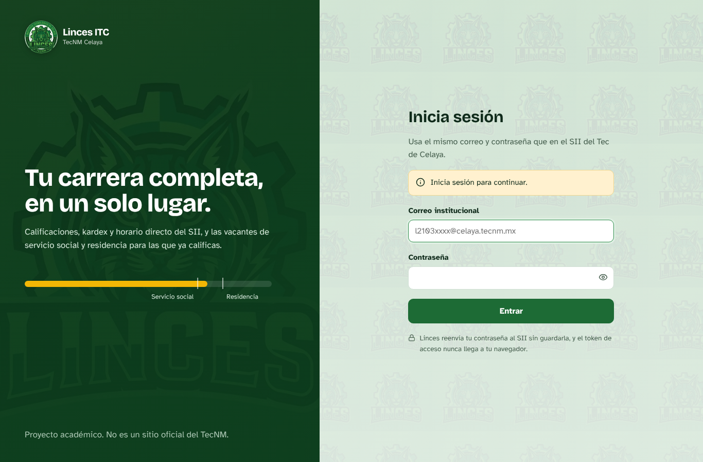 | 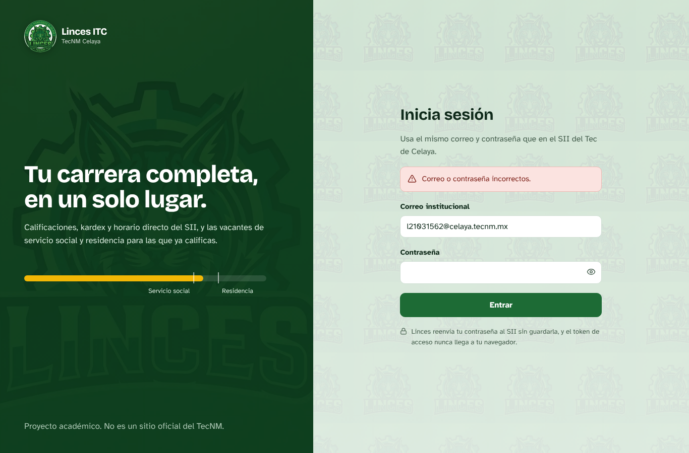 |

| Inicio | Calificaciones |
|---|---|
| 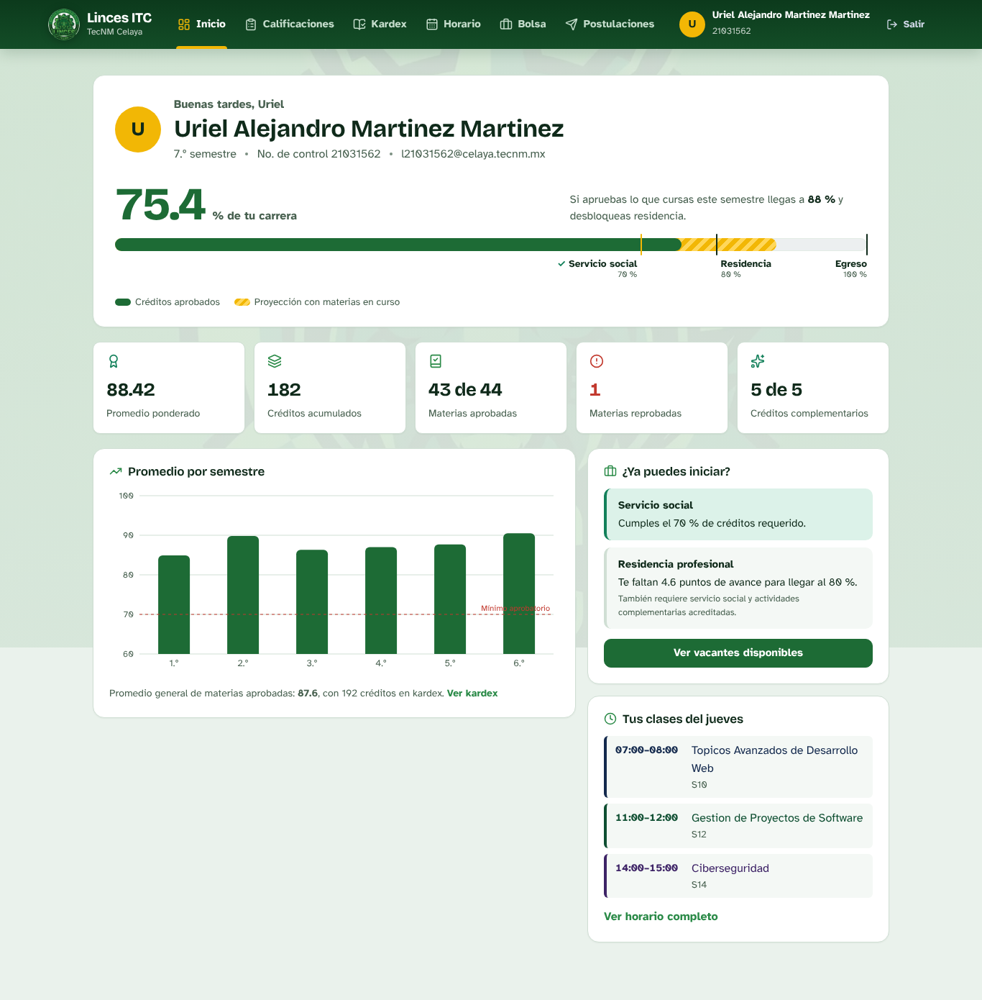 | 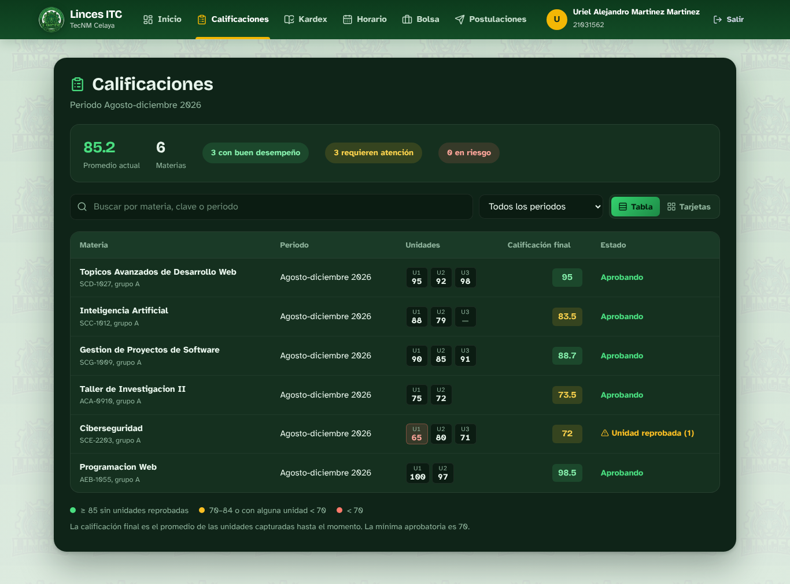 |

| Kardex | Horario |
|---|---|
| 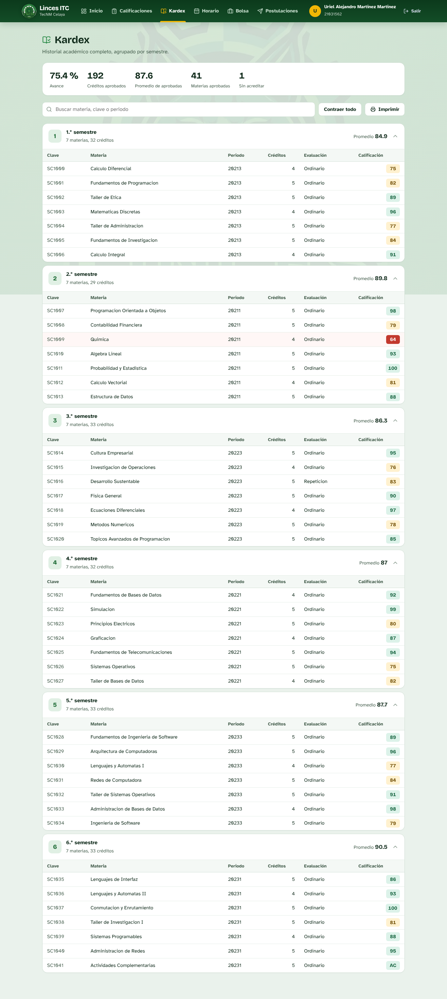 | 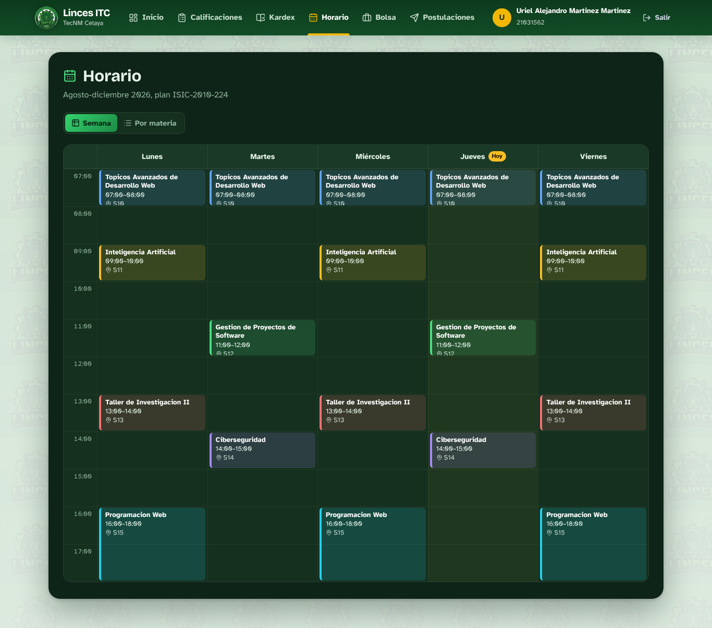 |

| Bolsa | Detalle y postulación |
|---|---|
| 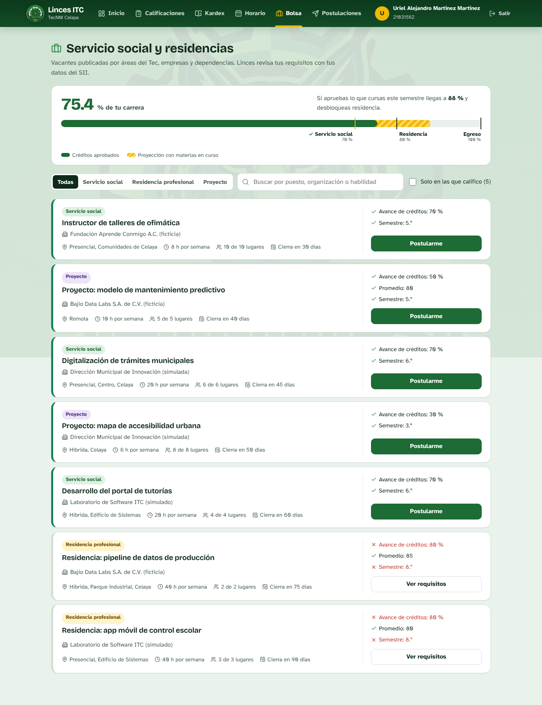 | 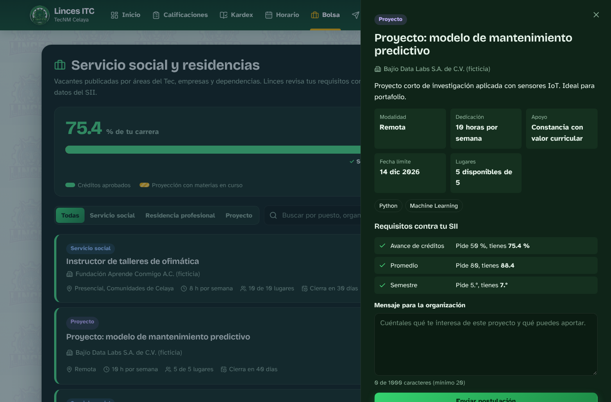 |

| Mis postulaciones | Token inválido |
|---|---|
| 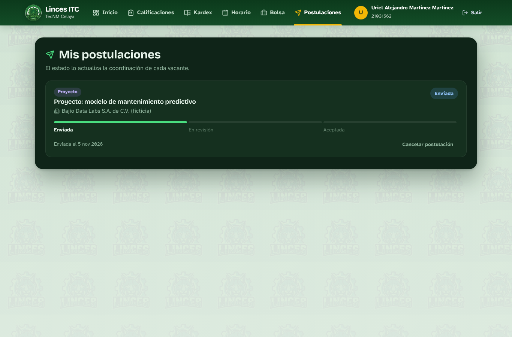 | 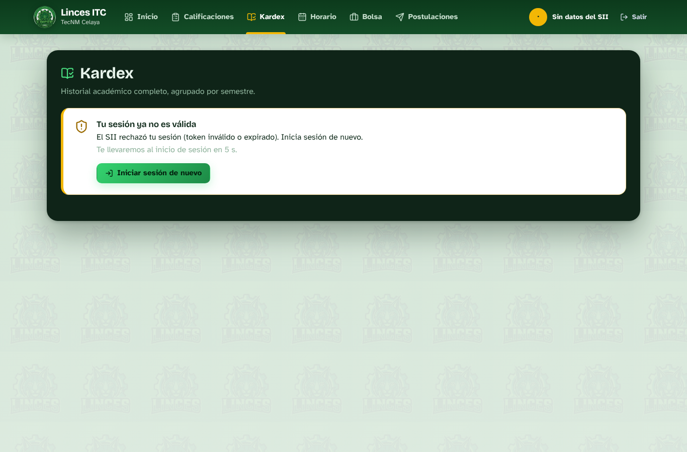 |

| Admin: resumen | Admin: postulaciones |
|---|---|
| 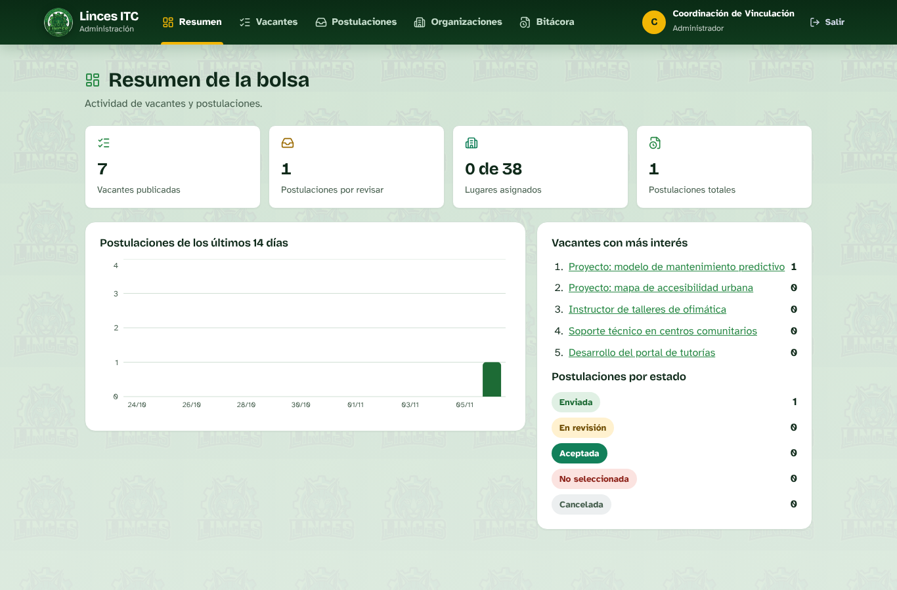 | 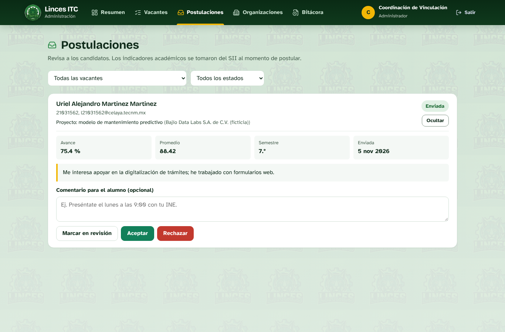 |

| Celular |
|---|
| 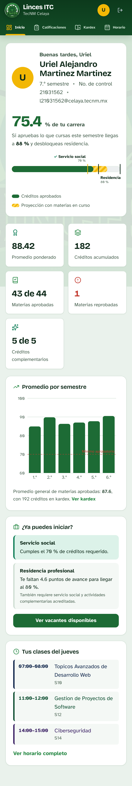 |

---

## 13. Preguntas frecuentes para la defensa

**"El documento dice que la app debe interactuar directamente con la API del SII. ¿Por qué pasan por un backend?"**
La misma sección **BackEnd** del documento pide que el backend local sea "un intermediario seguro entre el frontend y la API institucional". "Directamente" se refiere a usar la API real y no simular respuestas: cada pantalla de los puntos 1 a 4 se alimenta de una llamada real al SII en ese momento. Si el navegador llamara al SII, el token quedaría expuesto en el navegador.

**"¿Dónde guardan el token JWT?"**
En Supabase A, cifrado con AES-256-GCM. El navegador solo tiene un ID opaco en una cookie `HttpOnly`. Esto se puede demostrar en DevTools: `document.cookie` vacío y ningún `Authorization` en la pestaña Red.

**"¿Guardan calificaciones o kardex?"**
No. Se consultan en vivo en cada petición. Solo se guarda una foto mínima (avance, promedio, semestre y créditos) al postularse, como evidencia de elegibilidad.

**"¿Cómo saben que el token expiró?"**
De tres formas: el BFF lee el `exp` del JWT y fija con él la expiración de la sesión; el cliente programa el cierre a esa hora; y si el SII rechaza el token antes, la sesión se elimina y se responde `TOKEN_EXPIRED`.

**"¿Por qué la calificación final es un promedio?"**
El endpoint de calificaciones solo entrega las unidades. La final se calcula en el backend con las unidades capturadas, y también se marca cuando una unidad está por debajo de 70.

**"¿Por qué React + Vite y no Next.js?"**
Es una SPA privada: no necesita SEO ni SSR, Vite da HMR instantáneo y build ligero, y la seguridad que Next resolvería con API Routes la resolvemos con el BFF y el gateway, que además es el backend local que pide el examen.

**"¿Por qué dos bases de datos?"**
Operación descentralizada: cada servicio es dueño de sus datos. Si la bolsa falla, el login y la consulta académica siguen funcionando, y una filtración en un servicio no expone los datos del otro.

**"¿El alumno puede postularse aunque no cumpla?"**
No. El botón se oculta en el frontend, pero la validación real está en el BFF, que vuelve a consultar el SII en el momento de postularse.

**"¿Qué pasa si inicio sesión en dos lugares?"**
Sesión única: la anterior se cierra en el servidor y ese dispositivo muestra el motivo. El logout en una pestaña cierra todas las pestañas.

---

## 14. Guion de la exposición

Todos los integrantes participan.

1. **Propuesta:** problema y beneficios de la bolsa ([PROPUESTA.md](docs/PROPUESTA.md)).
2. **Tecnología y arquitectura:** las dos capas de backend, el diagrama de 3 servicios y 2 bases, y la justificación de React + Vite y Express.
3. **Demo en vivo con el SII real:**
   - login con contraseña incorrecta y luego correcta;
   - Inicio, Calificaciones (filtro y semáforo), Kardex y Horario;
   - postularse;
   - en el panel admin, aceptar la postulación con un comentario;
   - el alumno ve el cambio.
4. **Seguridad:**
   - mostrar DevTools (pestaña Red solo con `/api`, `document.cookie` vacío, cookie `HttpOnly`);
   - abrir el BFF directo y ver el 404;
   - cerrar sesión en una pestaña y ver que se cierra la otra;
   - correr `tools/auditoria.mjs`.

---

## 15. Estructura del repositorio y equipo

```
Linces-ITC/
├── bff/                  # Backend local (Express + TS) → SII + Supabase A
├── vacantes-service/     # Funcionalidad adicional + API admin → Supabase B
├── frontend/             # React + Vite + gateway server.js
├── supabase/
│   ├── core/             # SQL de Supabase A
│   └── vacantes/         # SQL de Supabase B + datos simulados
├── docs/                 # Propuesta y capturas
├── tools/auditoria.mjs   # Auditoría de seguridad
└── render.yaml           # Blueprint de Render (3 servicios)
```

**Equipo**
- Uriel Alejandro Martínez Martínez
- Rafael Barranco Mendoza
