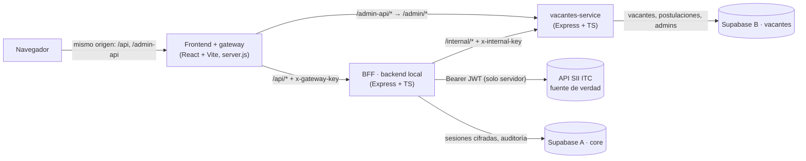
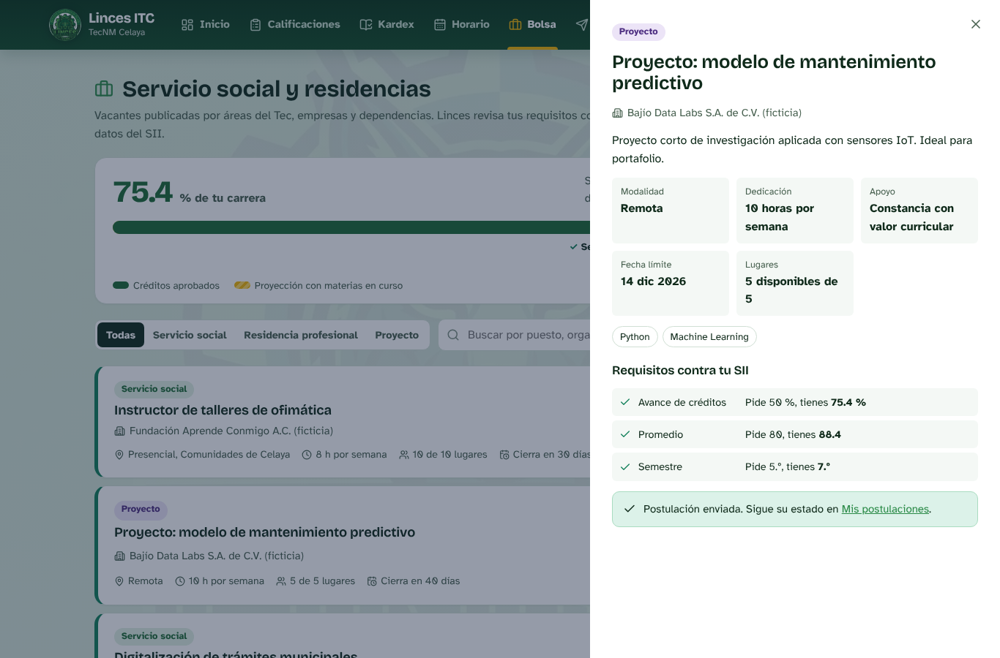

# Linces ITC

Aplicación web para estudiantes del **TecNM Campus Celaya** que consume el **API SII ITC** para mostrar perfil, calificaciones, kardex y horario. Incluye una funcionalidad propia: la **Bolsa de Servicio Social, Residencias y Proyectos**, que cruza los requisitos de cada vacante con tus datos reales del SII.

> Examen 3 · Consumo de API y Desarrollo de Interfaz Web · Tópicos Avanzados de Desarrollo Web
> Proyecto académico. No es un sitio oficial del TecNM.

**Producción:** `https://linces-itc.onrender.com` _(actualizar con la URL real)_

---

## Contenido

1. [Cumplimiento del examen](#cumplimiento-del-examen)
2. [Arquitectura](#arquitectura)
3. [Tecnologías elegidas](#tecnologías-elegidas)
4. [Seguridad](#seguridad)
5. [Instalación y ejecución local](#instalación-y-ejecución-local)
6. [Despliegue en Render](#despliegue-en-render)
7. [Endpoints](#endpoints)
8. [Capturas de pantalla](#capturas-de-pantalla)
9. [Guion para la exposición](#guion-para-la-exposición)
10. [Auditoría de seguridad](#auditoría-de-seguridad)

---

## Cumplimiento del examen

| Punto | Requisito | Dónde se cumple |
|---|---|---|
| 1 | Pantalla de login con correo y contraseña | `frontend/src/pages/Login.tsx` |
| 1 | `POST /api/login` al SII | `bff/src/lib/sii.ts` → `siiLogin()` |
| 1 | Guardar el JWT de forma segura | Cifrado AES-256-GCM en Supabase A; el navegador solo recibe una cookie HttpOnly con un ID opaco (`bff/src/services/sessionStore.ts`) |
| 1 | Errores: credenciales incorrectas, servidor caído, campos vacíos | `INVALID_CREDENTIALS`, `SII_UNAVAILABLE`/`BACKEND_DOWN`, validación en cliente y en servidor (zod) |
| 1 | Redirigir al dashboard al autenticarse | `Login.tsx` → `/dashboard` |
| 1 | Proteger rutas: sin token o token expirado → login | `RequireAuth.tsx` + `requireSession` (lee el `exp` del JWT, inactividad de 20 min y rechazo del SII) |
| 2 | `GET /api/movil/estudiante` con el token | `GET /api/estudiante` del BFF |
| 2 | Dashboard con tarjetas, gráficas e íconos | Pista de créditos, 5 indicadores, gráfica de promedio por semestre, elegibilidad y clases de hoy |
| 2 | Spinner o skeleton | `Skeleton`, `SkeletonRows`, `Spinner` (`components/Feedback.tsx`) |
| 2 | Mensaje claro si el token es inválido | `ErrorState`: explica el motivo y regresa al login con cuenta regresiva |
| 3 | `GET /api/movil/estudiante/calificaciones` | `GET /api/calificaciones` |
| 3 | Tabla o tarjetas con materia, periodo y calificación final | Ambas vistas; la final es el promedio de las unidades capturadas |
| 3 | Búsqueda en tiempo real por materia o periodo | Buscador + selector de periodo + filtro por color |
| 3 | Semáforo verde / amarillo / rojo | ≥ 85 sin unidades reprobadas / 70–84 o alguna unidad < 70 / < 70 |
| 4 | Kardex y horario en rutas independientes | `/kardex` y `/horario` |
| 4 | Kardex estructurado | Agrupado por semestre (acordeón), resumen, búsqueda e impresión |
| 4 | Horario por día y hora | Cuadrícula semanal hora × día (en móvil, por día) y vista por materia |
| 4 | Navegación fluida | SPA con React Router; barra lateral en escritorio y barra inferior en móvil |
| 5 | Funcionalidad original con backend de administración | Bolsa de vacantes + `vacantes-service` con panel `/admin` ([propuesta](docs/PROPUESTA.md)) |
| Back | El SII es la única fuente de verdad y el backend local es el intermediario seguro | El navegador nunca habla con el SII; no se persisten datos académicos |
| Entrega | README, framework, capturas y despliegue | Este archivo y `render.yaml` |

---

## Arquitectura

**Datos centralizados, operación descentralizada.** El SII es la fuente única de autenticación y datos académicos, y cada base de Supabase pertenece a un solo servicio. Los tres servicios se despliegan, escalan y fallan de forma independiente.



| Servicio | Carpeta | Responsabilidad | Base de datos |
|---|---|---|---|
| Frontend + gateway | `frontend/` | Interfaz del alumno y del panel admin; reenvía `/api` y `/admin-api` del lado del servidor | — |
| BFF (backend local) | `bff/` | Login contra el SII, sesiones, consumo del SII, normalización (calificación final, semáforo, kardex por semestre, horario), elegibilidad | Supabase A |
| vacantes-service | `vacantes-service/` | Bolsa de vacantes: API interna para el BFF y API de administración con auth propia | Supabase B |

### Flujo de login

```
1. Navegador ──POST /api/auth/login {email,password}──▶ gateway ──▶ BFF
2. BFF ──POST https://sii.celaya.tecnm.mx/api/login──▶ SII   (HTTP 200 siempre; el estado real viene en body.status)
3. BFF ──GET /movil/estudiante──▶ SII (número de control)
4. BFF guarda en Supabase A: sha256(id_sesión), JWT cifrado AES-256-GCM, expira_en = exp del JWT
5. BFF ──Set-Cookie: __Host-linces_sid=<id aleatorio>; HttpOnly; Secure; SameSite=Lax──▶ navegador
   (la respuesta NO contiene el token)
```

---

## Tecnologías elegidas

### Frontend: React + Vite

- **Por qué:** SPA rápida con recarga instantánea (HMR), sin la configuración ni el costo de un servidor SSR. Los datos son privados por alumno y no necesitan SEO ni renderizado en servidor.
- **Ventajas:** ecosistema grande (React Router, Recharts, Lucide), build estático muy ligero y la misma base de React que ya usamos en prácticas anteriores.
- **Decisión clave:** en lugar de un sitio estático, Render ejecuta un **gateway mínimo (`server.js`)** que sirve el build y hace de proxy hacia los backends. Así el navegador solo conoce su propio dominio y las cookies son *first-party*. Esto importa porque `onrender.com` está en la Public Suffix List: dos subdominios de Render se tratan como sitios distintos.
- Librerías: React 19, React Router, Recharts (gráficas), Lucide (íconos), Bricolage Grotesque + Atkinson Hyperlegible (tipografías autoalojadas, sin CDN).

### Backend: Express + TypeScript (Node 22)

- **Por qué:** ya lo dominamos (prácticas de Express, Coolify y Render), arranca rápido en el plan gratuito de Render y basta para un BFF. NestJS daría más estructura con más curva de aprendizaje; Laravel requeriría Docker en Render porque no hay runtime PHP nativo.
- Librerías: `helmet` (cabeceras), `express-rate-limit`, `zod` (validación), `cookie-parser`, `@supabase/supabase-js`, `pino` (logs con datos sensibles ocultos) y `bcryptjs` (contraseñas de admins).

### Datos: Supabase (2 proyectos)

- **A · core:** `sesiones` y `auditoria`. Solo la usa el BFF.
- **B · vacantes:** `organizaciones`, `vacantes`, `postulaciones`, `admins`, `admin_sesiones` y `bitacora_admin`. Solo la usa vacantes-service.
- RLS activado **sin políticas**: con la llave pública (anon/publishable) no se puede leer nada. Solo la secret key, que vive en el servidor, tiene acceso.

---

## Seguridad

| Riesgo | Medida |
|---|---|
| Token visible en el navegador (DevTools, `localStorage`, JS) | El JWT del SII nunca sale del servidor. La cookie contiene un ID aleatorio de 256 bits, `HttpOnly` (JS no la lee), `Secure`, `SameSite=Lax` y con prefijo `__Host-`. `document.cookie`, `localStorage` y `sessionStorage` quedan vacíos (verificado). |
| Robo de la base de sesiones | En BD solo está el **hash SHA-256** del ID de sesión y el JWT **cifrado AES-256-GCM** con una llave que solo tiene el BFF. |
| Ver cómo consumimos el API | El navegador solo ve `/api/...` de su mismo dominio. La URL del SII, la del BFF y los headers `Authorization` nunca aparecen en la pestaña Red. CSP `connect-src 'self'`. |
| Acceso directo a los backends en Render | El BFF y `/admin` exigen `x-gateway-key`, que inyecta el gateway; `/internal` exige `x-internal-key`, que solo tiene el BFF. Sin llave responden 404. |
| CSRF | `SameSite`, header obligatorio `x-linces-csrf` en peticiones que modifican datos y validación de `Origin`. No hay CORS. |
| Fuerza bruta | Rate limit de 10 intentos por IP y correo cada 10 minutos (alumnos y admins). |
| Sesiones viejas | Expiran con el `exp` del JWT (máx. 8 h), por 20 min de inactividad (servidor y cliente), y se eliminan si el SII rechaza el token. El logout borra la sesión en BD. |
| XSS / clickjacking | CSP estricta, `frame-ancestors 'none'`, Helmet en los 3 servicios. React escapa el contenido. |
| Datos privados en caché | `Cache-Control: no-store` en todas las respuestas académicas. |
| Fugas en logs | Pino oculta `cookie`, `authorization`, contraseñas y tokens. |
| Validación del lado del cliente | La elegibilidad para postularse se recalcula en el BFF con datos frescos del SII. |

> Las DevTools **siempre** muestran las cookies del sitio, incluso las `HttpOnly`. Lo que garantiza este diseño es que la cookie no sirve fuera de este dominio, no contiene el token del SII y se puede revocar.

---

## Instalación y ejecución local

### Requisitos

- Node.js 22 (`nvm install 22`)
- Dos proyectos en [Supabase](https://supabase.com) (el plan gratuito permite 2 activos)
- Cuenta institucional del SII para probar

### 1. Bases de datos

En cada proyecto de Supabase abre **SQL Editor → New query** y ejecuta:

| Proyecto | Scripts |
|---|---|
| A · core | `supabase/core/001_core.sql` |
| B · vacantes | `supabase/vacantes/001_vacantes.sql` y después `supabase/vacantes/002_seed_simulado.sql` |

De cada proyecto copia la **Project URL** y la **Secret key** (`sb_secret_…`, o la `service_role` si tu proyecto usa llaves legacy) desde **Project Settings → API Keys**.

### 2. Variables de entorno

```bash
cp bff/.env.example bff/.env
cp vacantes-service/.env.example vacantes-service/.env
cp frontend/.env.example frontend/.env
```

Genera los secretos con:

```bash
node -e "console.log(require('crypto').randomBytes(32).toString('hex'))"
```

| Variable | Dónde | Valor |
|---|---|---|
| `SESSION_ENC_KEY` | bff | secreto aleatorio |
| `VACANTES_INTERNAL_KEY` (bff) = `INTERNAL_KEY` (vacantes) | ambos | el mismo secreto |
| `GATEWAY_KEY` (bff) = `BFF_GATEWAY_KEY` (frontend) | ambos | el mismo secreto (opcional en local) |
| `GATEWAY_KEY` (vacantes) = `ADMIN_GATEWAY_KEY` (frontend) | ambos | el mismo secreto (opcional en local) |

### 3. Instalar y levantar (3 terminales)

```bash
cd vacantes-service && npm install && npm run dev   # :4100
cd bff              && npm install && npm run dev   # :4000
cd frontend         && npm install && npm run dev   # :5173
```

Crea el primer administrador de la bolsa:

```bash
cd vacantes-service
npm run crear-admin -- coordinacion@ejemplo.com "UnaContraseñaLarga-2026" "Coordinación de Vinculación" admin
```

- Alumnos: <http://localhost:5173/login> (cuenta del SII)
- Administración: <http://localhost:5173/admin/login>

Para probar el build de producción en local: `cd frontend && npm run build && BFF_URL=http://localhost:4000 ADMIN_SERVICE_URL=http://localhost:4100 npm start` → <http://localhost:3000>.

---

## Despliegue en Render

### Opción A: Blueprint (recomendada)

1. Sube el repositorio a GitHub.
2. Render → **New → Blueprint** → elige el repo. Render lee `render.yaml` y crea `linces-bff`, `linces-vacantes` y `linces-itc`. Las llaves compartidas se generan y enlazan solas.
3. Captura las variables marcadas como `sync: false`:

| Servicio | Variable | Valor |
|---|---|---|
| linces-bff | `SUPABASE_CORE_URL`, `SUPABASE_CORE_SECRET_KEY` | proyecto A |
| linces-bff | `VACANTES_URL` | `https://linces-vacantes.onrender.com` |
| linces-bff | `ALLOWED_ORIGINS` | `https://linces-itc.onrender.com` |
| linces-vacantes | `SUPABASE_VACANTES_URL`, `SUPABASE_VACANTES_SECRET_KEY` | proyecto B |
| linces-vacantes | `ALLOWED_ORIGINS` | `https://linces-itc.onrender.com` |
| linces-itc | `BFF_URL` | `https://linces-bff.onrender.com` |
| linces-itc | `ADMIN_SERVICE_URL` | `https://linces-vacantes.onrender.com` |

4. Si Render asignó otras URLs (por ejemplo con sufijo aleatorio), corrige estas variables con las URLs reales y haz **Manual Deploy**.

### Opción B: manual

Crea 3 **Web Services** (runtime Node) con *Root Directory* `bff`, `vacantes-service` y `frontend`:

- Build: `npm ci --include=dev && npm run build`. El `--include=dev` es necesario porque con `NODE_ENV=production` npm omitiría TypeScript y Vite.
- Start: `npm start`
- Health check: `/health`

Copia las mismas variables de la tabla anterior y además las llaves compartidas.

### Notas del plan gratuito

- Render apaga cada servicio tras **15 minutos sin tráfico**, y el primer request puede tardar alrededor de un minuto. **Antes de la exposición abre `/health` de los 3 servicios.** El gateway espera hasta 60 s y muestra "El servidor está iniciando".
- Supabase pausa los proyectos tras **7 días sin uso**; reactívalos desde el dashboard antes de la demo.
- Los servicios gratuitos de Render no reciben tráfico de red privada, así que la comunicación entre servicios usa las URLs públicas protegidas por llaves.

---

## Endpoints

### BFF (navegador → `/api/*`)

| Método | Ruta | Descripción |
|---|---|---|
| POST | `/auth/login` | Login contra el SII; crea la sesión y la cookie |
| GET | `/auth/session` | Estado de la sesión (para proteger rutas) |
| POST | `/auth/logout` | Elimina la sesión |
| GET | `/estudiante` | Perfil + elegibilidad de servicio social y residencia |
| GET | `/calificaciones` | Materias, parciales, calificación final, semáforo y resumen |
| GET | `/kardex` | Kardex agrupado por semestre y resumen |
| GET | `/horario` | Sesiones por día y hora |
| GET | `/vacantes?tipo=&q=` | Vacantes publicadas con la elegibilidad del alumno |
| GET | `/vacantes/:id` | Detalle de una vacante |
| POST | `/vacantes/:id/postulaciones` | Postularse (valida requisitos con el SII) |
| GET | `/postulaciones` | Mis postulaciones |
| POST | `/postulaciones/:id/cancelar` | Cancelar una postulación pendiente |

### vacantes-service

- `/internal/*` (solo BFF): `GET /vacantes`, `GET /vacantes/:id`, `GET|POST /postulaciones` y `POST /postulaciones/:id/cancelar`.
- `/admin/*` (panel, vía `/admin-api/*`):
  - `POST /auth/login|logout` y `GET /auth/me`
  - `GET /estadisticas`
  - CRUD de `/organizaciones` y `/vacantes`
  - `GET /postulaciones` y `PATCH /postulaciones/:id`
  - `GET /bitacora`

---

## Capturas de pantalla

> ⚠️ Las capturas de `docs/capturas/` se tomaron en desarrollo. **Antes de entregar, reemplázalas por capturas de producción conectadas al SII real** con los mismos nombres de archivo.

| Login | Error de credenciales |
|---|---|
|  |  |

| Dashboard | Calificaciones |
|---|---|
|  |  |

| Kardex | Horario |
|---|---|
|  |  |

| Bolsa de vacantes | Postulación |
|---|---|
|  |  |

| Token inválido | Móvil |
|---|---|
|  |  |

| Admin: resumen | Admin: postulaciones |
|---|---|
|  |  |

---

## Guion para la exposición

Todos los integrantes deben participar. Reparto sugerido:

1. **Problema y propuesta**: la bolsa de vacantes y por qué ayuda a los alumnos ([PROPUESTA.md](docs/PROPUESTA.md)).
2. **Tecnología y arquitectura**: por qué React + Vite y Express, el diagrama de 3 servicios y las 2 bases de datos, y "datos centralizados, operación descentralizada".
3. **Demo en vivo con el SII real**:
   - login con contraseña incorrecta y luego correcta;
   - dashboard, calificaciones (filtro y semáforo), kardex y horario;
   - postularse a una vacante;
   - en el panel admin, aceptar la postulación, y como alumno, ver el cambio de estado.
4. **Seguridad**: abrir DevTools y mostrar que la pestaña Red solo tiene `/api/...`, que `document.cookie` y `localStorage` están vacíos y que la cookie es `HttpOnly` con un ID opaco. Luego, llamar al BFF directo en su URL de Render y mostrar el 404 sin `x-gateway-key`.

---

## Auditoría de seguridad

`tools/auditoria.mjs` revisa unas 70 cosas sin imprimir nunca tokens ni contraseñas:

- el bundle público (que no traiga secretos ni URLs internas);
- la cookie de sesión y sus atributos;
- que ninguna respuesta de la API traiga tokens;
- CSRF, accesos sin sesión y path traversal;
- logout con revocación en el servidor;
- acceso directo a los backends;
- RLS de Supabase con la llave pública;
- rate limit;
- `.env` versionados y `npm audit`.

```bash
# Local (con los 3 servicios corriendo)
node tools/auditoria.mjs --url http://localhost:5173

# Producción (la prueba completa)
node tools/auditoria.mjs --url https://linces-itc.onrender.com \
  --bff https://linces-bff.onrender.com --vacantes https://linces-vacantes.onrender.com \
  --supabase https://REF_CORE.supabase.co=sb_publishable_xxx \
  --supabase https://REF_VAC.supabase.co=sb_publishable_yyy --rate
```

Termina con código 1 si alguna prueba falla.

## Estructura

```
linces-itc/
├── bff/                  # Backend local (Express + TS) → SII + Supabase A
├── vacantes-service/     # Funcionalidad adicional + API admin → Supabase B
├── frontend/             # React + Vite + gateway server.js
├── supabase/
│   ├── core/             # SQL de Supabase A
│   └── vacantes/         # SQL de Supabase B + datos simulados
├── docs/                 # Propuesta y capturas
├── tools/auditoria.mjs   # Auditoría de seguridad
└── render.yaml           # Blueprint de Render
```

## Equipo

- Uriel Alejandro Martínez Martínez (21031562)
- _Agregar integrantes_
